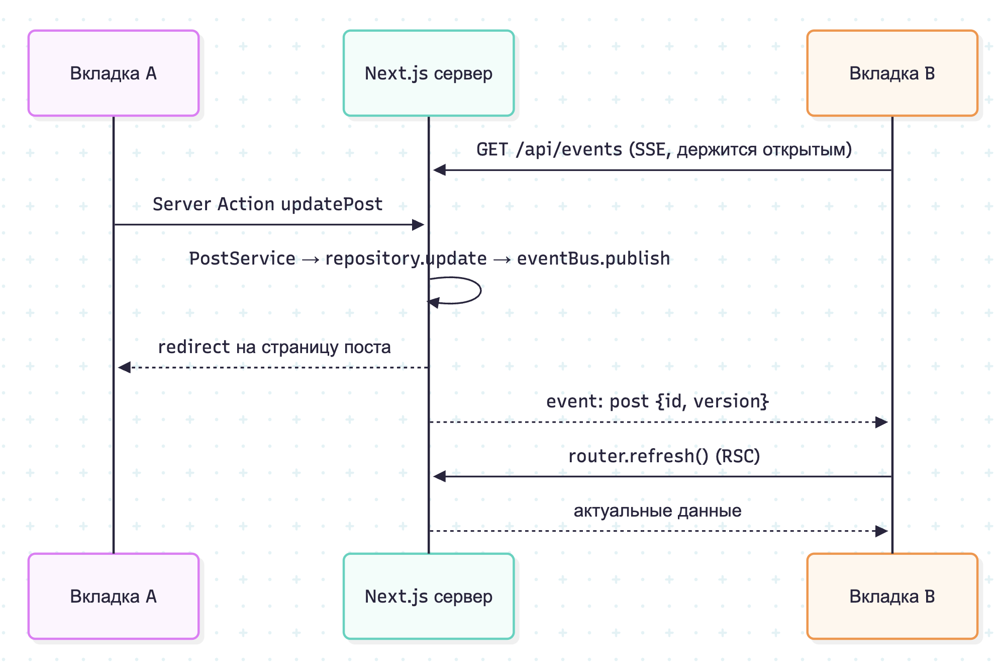

# Блог с синхронизацией между вкладками

Тестовое задание frankrg. Простой блог на Next.js (App Router): данные хранятся в памяти сервера, а изменения из одной вкладки без перезагрузки появляются во всех остальных, в том числе в другом браузере.

## Запуск

Нужен Node.js 22+.

```bash
npm install
npm run dev          # http://localhost:3000
```

Production-сборка:

```bash
npm run build
npm start
```

Docker:

```bash
docker build -t frankrg-blog .
docker run --rm -p 3000:3000 frankrg-blog
```

Чтобы проверить синхронизацию, откройте приложение в двух вкладках (или в двух разных браузерах) и создайте или отредактируйте пост в одной из них.

## Проверки

```bash
npm run lint
npm run lint:fsd     # границы слоёв FSD (steiger)
npm run typecheck
npm test             # unit (Vitest)
npm run test:coverage
npm run test:e2e     # e2e (Playwright) на production-сборке
```

Для e2e нужен браузер: `npx playwright install chromium`. Можно использовать и установленный Chrome: `PW_CHANNEL=chrome npm run test:e2e`.

## Архитектура

Код разложен по [Feature-Sliced Design](https://feature-sliced.design):

```
src/
  app/                          App Router: роутинг, страницы, layout, тонкий SSE-роут
  features/
    post-editor/                формы создания и редактирования (ui), их состояния и правило конфликта (model), Server Actions (api)
    live-sync/                  живая синхронизация: SSE-поток и клиентское соединение (api), компонент в layout (ui)
  entities/
    post/
      model/                    модель, zod-схема, PostService, интерфейсы репозитория и шины событий
      api/                      их in-memory реализации (compare-and-set по версии) и синглтоны
      index.ts                  типы (безопасно для клиента)
      index.server.ts           postService, postEvents (server-only)
  shared/
    ui/formatted-date.tsx
    lib/sse.ts
```

Правила импорта: слой импортирует только из слоёв ниже (`app` → `features` → `entities` → `shared`), слайсы одного слоя друг о друге не знают, снаружи слайса — только через его `index`. Внутри слайса зависимости тоже идут в одну сторону: `ui` и `api` зависят от `model`, `model` не зависит ни от чего. Межслойные правила проверяет официальный линтер steiger (`npm run lint:fsd`, он же в CI).

Осознанные отступления от канона:

- **Нет слоя `pages`.** Его роль играет `src/app`: роут-файл Next и есть страница, он грузит данные и собирает экран. Отдельный слой превратил бы каждый роут в однострочный реэкспорт и потребовал бы переименовать слои в `_app`/`_pages`, чтобы не конфликтовать с Next. Код, нужный одному роуту, можно положить рядом с ним в private folder Next (`_name`), такие папки не становятся роутами.
- **Нет виджетов.** Шапка из двух ссылок и таблица постов используются в одном месте каждая. Виджет появится, когда блок станет переиспользуемым (например, шапка с меню пользователя).
- **Одна фича `post-editor`, а не `create-post` + `edit-post`.** Формы делят общие поля и меняются вместе. С двумя фичами общий `PostForm` пришлось бы опустить в `entities`, хотя это UI редактирования, а не сущности.
- **Живая синхронизация — фича `live-sync`, а не инфраструктура `app`.** Это требование задания, видимое пользователю. Серверная и клиентская части SSE-канала лежат в одном слайсе, имена событий описаны один раз в `model`.
- **Хранилище живёт в `entities/post`.** Бэкенд здесь — сам процесс Next. Интерфейсы репозитория и шины событий — часть домена (`model`), а их in-memory реализации — слой доступа к данным (`api`). `index.server.ts` с `server-only` не даёт затащить их в клиентский бандл.



## Ключевые решения

- **SSE + `router.refresh()`.** Сервер шлёт только факт изменения, а клиент перечитывает данные через Server Components. Синхронизируется состояние, а не события: источник правды один, клиентского кэша нет, пропущенные за время обрыва события не страшны (после реконнекта тоже делается refresh). Синхронизируются любые клиенты, а не только вкладки одного браузера, как было бы с BroadcastChannel. WebSocket не нужен: канал односторонний, а для WebSocket понадобился бы кастомный сервер.
- **Синглтон на `globalThis`** (`entities/post/api/post-store.ts`). Next.js собирает route handlers и страницы в разные бандлы, а в dev HMR переисполняет модули. Обычный модульный синглтон раздвоился бы, и SSE-роут слушал бы не ту шину, в которую пишут Server Actions.
- **Динамические страницы** (`await connection()`). Без этого `next build` отрендерил бы список статически, и F5 показывал бы данные на момент сборки.
- **Optimistic concurrency.** У поста есть `version`, сохранение передаёт версию, с которой началось редактирование, а репозиторий делает compare-and-set. Если пост изменили в другом месте, форма показывает предупреждение и не затирает ни чужие, ни свои правки. Перезапись возможна только явно.
- **Зависимости через конструктор.** `PostRepository` и `PostEventBus` — интерфейсы, `PostService` получает их через конструктор. Unit-тесты используют настоящие in-memory реализации без моков.
- **Логика — в чистых функциях, компоненты — тонкие.** SSE-поток, клиентское соединение (debounce, реконнект), правило конфликта и Server Actions принимают зависимости параметрами и покрыты unit-тестами, включая очистку подписок при отключении клиента. Компоненты и страницы проверяют e2e.
- **Даты** выводятся в часовом поясе браузера. Сервер, например в Docker, живёт в UTC.

## Ограничения и что изменилось бы в продакшене

- Данные живут в памяти одного процесса: после рестарта остаются только демо-посты, горизонтально масштабировать нельзя. В проде: БД вместо `Map` (репозиторий станет асинхронным, compare-and-set превратится в `UPDATE … WHERE version = ?`) и Redis pub/sub или Postgres LISTEN/NOTIFY вместо `EventEmitter`.
- Браузеры держат не больше 6 HTTP/1.1-соединений на origin. SSE занимает одно на вкладку, поэтому при 7+ открытых вкладках новые будут ждать. Решения: HTTP/2 через reverse proxy или одно соединение на браузер через SharedWorker или leader election на BroadcastChannel.
